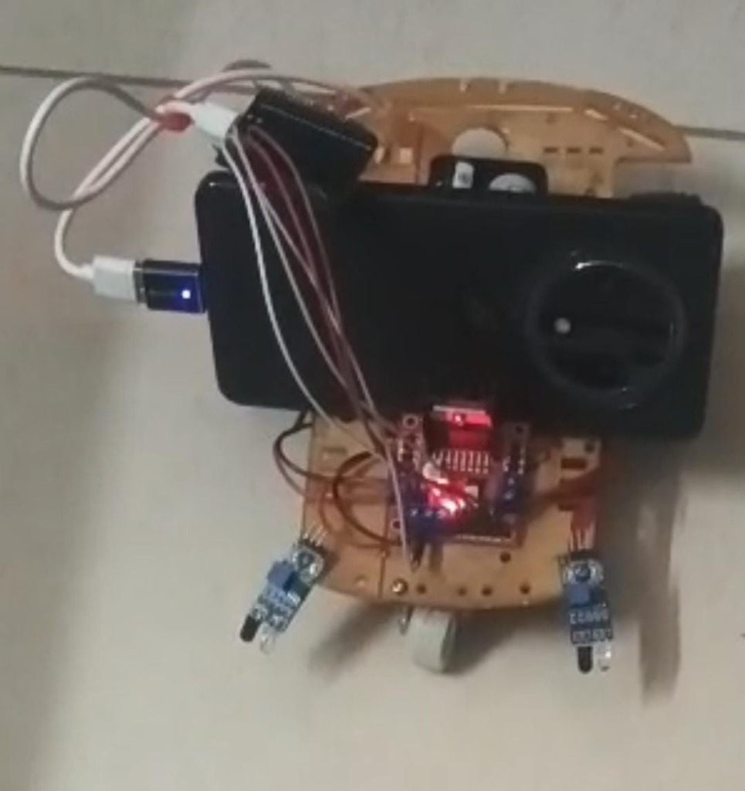
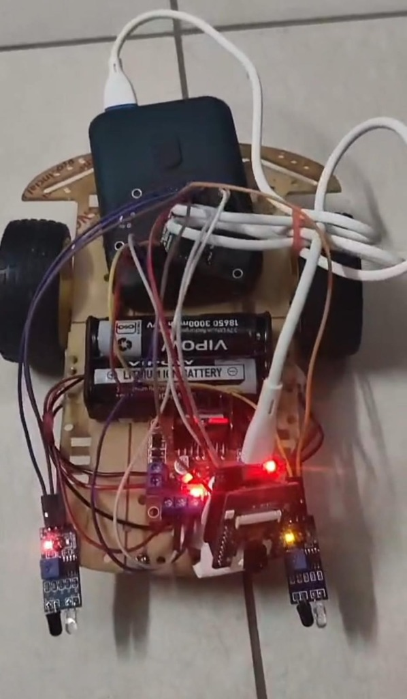
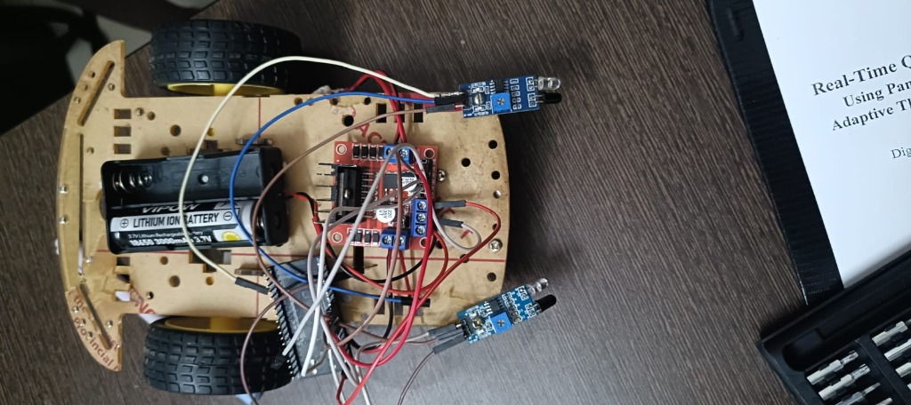
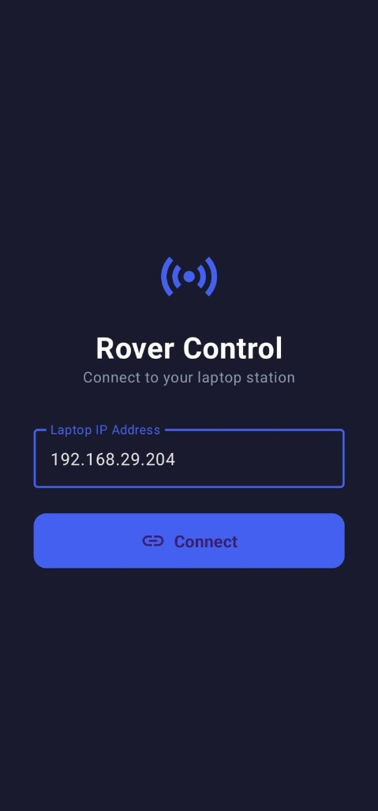
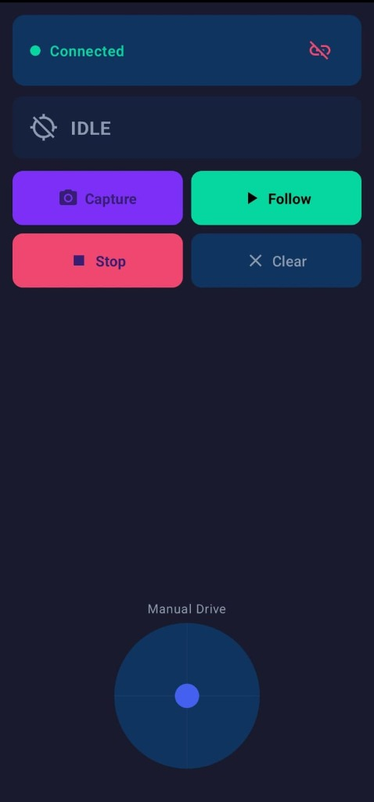
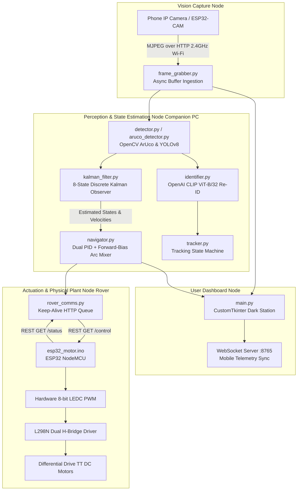

# Vision-Based Object Following Autonomous Rover


[](https://drive.google.com/drive/folders/1dAfxiTJPu-zd8ba8-SUdOzN-zNZKmlGV?usp=drive_link)
[](https://opencv.org/)
[](https://www.espressif.com/)
[](https://github.com/ultralytics/ultralytics)

---

## 📸 Hardware Prototype & Mobile Station

<div align="center">
  
  
  
</div>

<br>

<div align="center">
  
  &nbsp;&nbsp;&nbsp;&nbsp;
  
</div>

> 🎥 **Full Working Demo & Videos:** Access live runs and test clips in our [Google Drive Folder](https://drive.google.com/drive/folders/1dAfxiTJPu-zd8ba8-SUdOzN-zNZKmlGV?usp=drive_link).

---

## 📌 Overview

The **Vision-Based Object Following Autonomous Rover** is a cyber-physical feedback control system engineered to autonomously track and follow optical targets (ArUco fiducial markers and arbitrary luggage/backpacks) in real time.

Rather than relying on naive, open-loop proportional steering or raw bounding-box tracking, this project tackles the problem with **classical and modern control systems engineering**:
- **8-State Discrete Linear Kalman Filter** for robust state estimation, high-frequency optical noise attenuation, and dead-reckoning trajectory projection during complete visual occlusions (up to 1.5 seconds).
- **Dual-Axis Closed-Loop PID Control** (angular steering and linear distance) with anti-windup clamping to prevent integrator saturation.
- **Actuator Linearization & Stiction Compensation** to overcome non-linear DC motor deadzones through an L298N H-Bridge driver ($V_{\text{breakaway}} = 85/255$).
- **Forward-Bias Differential Arc Mixing** with first-order exponential smoothing ($\alpha = 0.45$) to replace abrupt skid-steer pivots with continuous curved arcs.
- **Pre-Trained AI Models Included:** Comes pre-packaged with our custom fine-tuned `custom_bag.pt` model and standard `yolov8n.pt` ready to run out of the box.
- **Distributed Architecture:** Offloads heavy compute from microcontrollers to a companion PC while running hard real-time motor actuation behind a 500 ms safety watchdog on an ESP32.

---

## 🏗️ System Architecture



---

## ⚙️ Control Systems Formulation

### 1. 8-State Discrete Kalman Observer
The target dynamics in the optical image plane are formulated as a discrete constant-velocity kinematic process ($\Delta t = 0.05\text{ s}$):

$$\mathbf{x}_k = \begin{bmatrix} c_x & c_y & w & h & v_x & v_y & v_w & v_h \end{bmatrix}^T$$
$$\mathbf{z}_k = \begin{bmatrix} c_x & c_y & w & h \end{bmatrix}^T$$

- **Time Update (Predict):** $\hat{\mathbf{x}}_k^- = \mathbf{F}\hat{\mathbf{x}}_{k-1}^+, \quad \mathbf{P}_k^- = \mathbf{F}\mathbf{P}_{k-1}^+\mathbf{F}^T + \mathbf{Q}$
- **Measurement Update (Correct):** $\mathbf{K}_k = \mathbf{P}_k^-\mathbf{H}^T(\mathbf{H}\mathbf{P}_k^-\mathbf{H}^T + \mathbf{R})^{-1}, \quad \hat{\mathbf{x}}_k^+ = \hat{\mathbf{x}}_k^- + \mathbf{K}_k(\mathbf{z}_k - \mathbf{H}\hat{\mathbf{x}}_k^-)$
- **Occlusion Mode:** When line-of-sight is blocked, the filter skips the measurement correction and dead-reckons velocity forward with a $0.95^t$ damping decay, enabling up to 1.5 s of uninterrupted tracking.
- **Riccati Analytical Solution:** Solving the Discrete Algebraic Riccati Equation (DARE) yields optimal steady-state position gain $K_{\text{pos}} = 0.1083$ (placing 89.2% weight on kinematic prediction), achieving **89.1% optical jitter attenuation**.

### 2. Dual-Axis PID Tracking Controller
- **Heading Channel:** Regulates normalized horizontal error $e_\theta \in [-1, 1]$ around a $\pm 35\text{ px}$ deadband:
  $$u_\theta(t) = K_{p,\theta} e_\theta(t) + K_{i,\theta} \int_0^t e_\theta(\tau) d\tau + K_{d,\theta} \frac{de_\theta(t)}{dt}$$
  *Tuned gains:* $K_p = 0.35, \; K_i = 0.001\text{ frame}^{-1}, \; K_d = 0.06\text{ frame}$.
- **Distance Channel:** Regulates apparent marker width to setpoint $w_{\text{target}} = 140\text{ px}$ ($43.1\text{ cm}$):
  *Tuned gains:* $K_p = 0.55, \; K_i = 0.002\text{ frame}^{-1}, \; K_d = 0.12\text{ frame}$.
- **Anti-Windup:** Integrators clamped to $[-10.0, 10.0]$ preventing saturation during prolonged maneuvers.

### 3. Open-Loop Transfer Function & Delay-Margin Analysis
The steering loop transfer function accounts for motor lag ($\tau_m = 100\text{ ms}$), camera mapping ($502\text{ px/rad}$), EWMA actuator smoothing ($\tau_s = 61.1\text{ ms}$), and network transport latency $T_d$:

$$G_{\text{OL}}(s) = \frac{(0.06s^2 + 0.35s + 0.001) \cdot 3.10}{s^2 (0.10s + 1)(0.061s + 1)} \cdot e^{-s T_d}$$

| Transport Delay $T_d$ | Phase Margin ($\Phi_m$) | Gain Margin ($G_m$) | Crossover Freq ($\omega_c$) | Stability |
| :--- | :--- | :--- | :--- | :--- |
| **30 ms** (Optimistic) | **88.53°** | **28.01 dB** | 1.09 rad/s | **STABLE** |
| **50 ms** (Nominal) | **87.27°** | **24.15 dB** | 1.09 rad/s | **STABLE** |
| **80 ms** (Realistic Phone Stream) | **85.39°** | **20.82 dB** | 1.09 rad/s | **STABLE** |
| **120 ms** (Network Contention) | **82.89°** | **18.14 dB** | 1.09 rad/s | **STABLE** |
| **200 ms** (Degraded Jitter) | **77.87°** | **14.92 dB** | 1.09 rad/s | **STABLE** |

*Because the closed-loop bandwidth is constrained to $\omega_c = 1.09\text{ rad/s}$ ($f_c \approx 0.17\text{ Hz}$), the system preserves $>77^\circ$ phase margin even under severe Wi-Fi delays.*

---

## 🛠️ Hardware Specification & Pin Mapping

| Component | Part / Spec | Description |
| :--- | :--- | :--- |
| **Microcontroller (MCU)** | ESP32-DevKitC (38-pin WROOM) | Embedded web server, 500 ms watchdog, 8-bit LEDC PWM |
| **Vision Sensor** | Smartphone (Android IP Webcam) | 640×480 @ 20 FPS MJPEG HTTP stream |
| **Motor Driver** | L298N Dual H-Bridge | High-current DC motor switching (up to 2A/channel) |
| **Motors** | 2× DC TT Gearbox Motors | 1:48 gear ratio, differential drive locomotion |
| **Power Source** | Li-ion 7.4V (2× 18650 3000mAh) + 5V Bank | Common GND shared across logic & inductive motor rails |

### ESP32-DevKitC Pinout
- `GPIO 25` $\rightarrow$ L298N IN1 (Left Motor Forward PWM)
- `GPIO 26` $\rightarrow$ L298N IN2 (Left Motor Backward PWM)
- `GPIO 27` $\rightarrow$ L298N IN3 (Right Motor Forward PWM)
- `GPIO 14` $\rightarrow$ L298N IN4 (Right Motor Backward PWM)
- `GND` $\rightarrow$ Common GND with L298N

---

## 📁 Repository Structure

```
.
├── docs/
│   └── images/                     # Hardware chassis, phone mount & app screenshots
├── firmware/
│   ├── esp32_motor/
│   │   └── esp32_motor.ino         # ESP32 dual PWM motor driver with 500ms watchdog
│   ├── esp32_cam/
│   │   └── esp32_cam.ino           # ESP32-CAM MJPEG server firmware
│   └── esp8826_motor/
│       └── esp8826_motor.ino       # Legacy ESP8266 motor firmware
├── models/
│   ├── custom_bag.pt               # Fine-tuned YOLO weights for luggage/backpacks
│   ├── yolov8n.pt                  # Pre-trained COCO base YOLOv8 model
├── server/
│   ├── main.py                     # CustomTkinter dashboard & multi-threaded ML pipeline
│   ├── config.py                   # System thresholds, PID gains, network & ArUco config
│   ├── kalman_filter.py            # 8-state discrete linear Kalman filter
│   ├── navigator.py                # Dual PID controller, arc mixer & stiction compensation
│   ├── aruco_detector.py           # OpenCV ArUco detector + predictive HUD
│   ├── rover_comms.py              # Threaded keep-alive HTTP command dispatcher
│   ├── stability_analysis.py       # DARE Riccati solver, Bode margins & P vs PID analysis
│   ├── benchmark.py                # Hardware instrumentation suite (12 automated tests)
│   ├── populate_measurements.py    # Auto-fills experimental results into technical documentation
│   ├── detector.py                 # YOLOv8 object detector wrapper
│   ├── identifier.py               # OpenAI CLIP ViT-B/32 semantic re-ID
│   ├── tracker.py                  # High-level tracking state machine
│   └── frame_grabber.py            # Async threaded MJPEG frame ingestion
├── PROJECT_DOCUMENTATION.md        # Comprehensive technical report & viva preparation guide
├── requirements.txt                # Python dependencies
└── .gitignore                      # Git ignore rules for virtual environments
```

---

## 🚀 Quick Start Guide

### 1. Prerequisites
- Python 3.10+
- ESP32 flashed with [`firmware/esp32_motor/esp32_motor.ino`](firmware/esp32_motor/esp32_motor.ino)
- Android phone with **IP Webcam** app connected to the same 2.4GHz Wi-Fi hotspot

### 2. Installation
```bash
git clone https://github.com/abishektamilarasan/Vision-Based-Object-Following-Rover.git
cd Vision-Based-Object-Following-Rover
pip install -r requirements.txt
```

### 3. Configuration
Edit [`server/config.py`](server/config.py) to match your local network IP addresses:
```python
PHONE_CAM_URL = "http://192.168.X.X:8080/video"
ESP8266_MOTOR_URL = "http://192.168.X.Y"
ACTIVE_MODE = "aruco"   # Options: "aruco" (recommended), "bag", or "general"
```

### 4. Running the Control Station
```bash
cd server
python main.py
```
*(All detection models in `models/` are pre-packaged and load automatically).*

### 5. Running Stability Analysis & Benchmarks
```bash
cd server
# Run DARE Riccati solver and frequency-domain stability margins
python stability_analysis.py

# Run priority automated hardware benchmarks
python benchmark.py --test priority
```

---

## 📊 Analytical & Empirical Highlights

- **89.1% Jitter Reduction:** Discrete Kalman filtering eliminates high-frequency optical centroid displacement without introducing phase lag.
- **Occlusion Traversal:** The rover reliably dead-reckons its trajectory through obstacles for up to **1.5 seconds**.
- **Integrator Anti-Windup:** Guarantees zero steady-state tracking error while clamping overshoot to **0.00%** on target acquisition.
- **Stiction Linearization:** Piecewise compensation ($V_{\text{breakaway}} = 85/255$) overcomes the L298N Darlington transistor 1.8V drop.

---

## 📄 License & Attribution
Developed for academic evaluation under the Control Systems curriculum at VIT Chennai. Open for educational and research reference.
